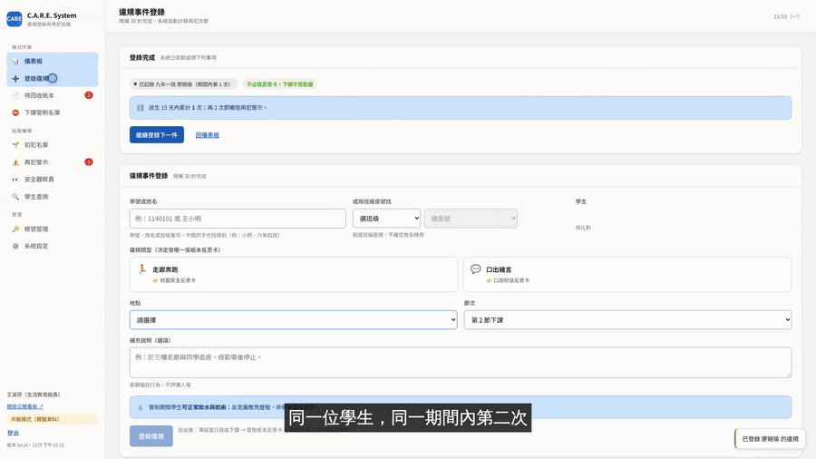
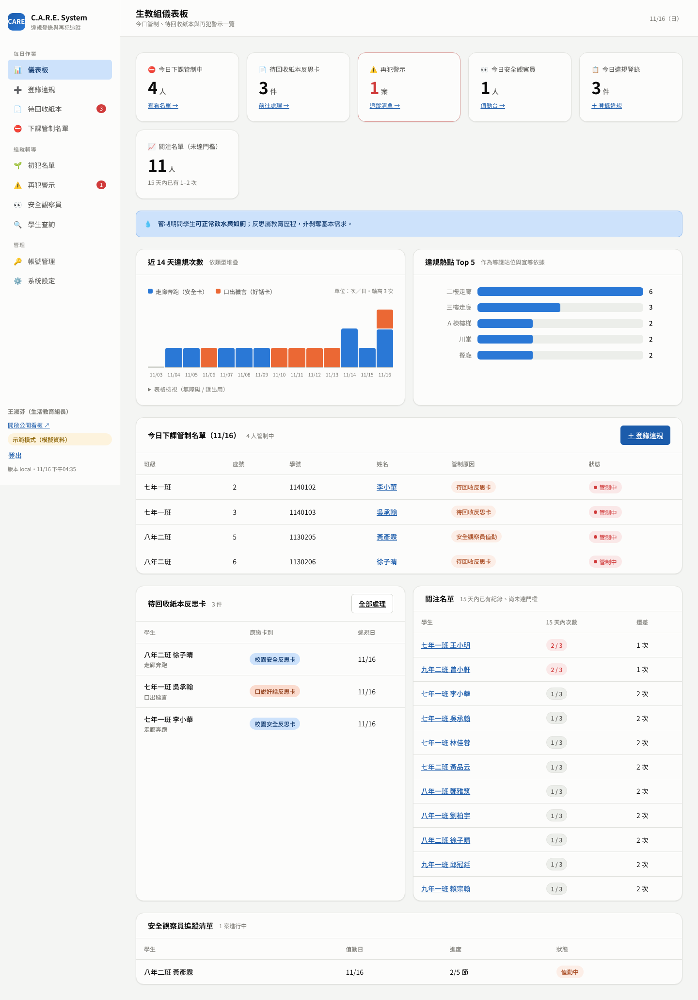
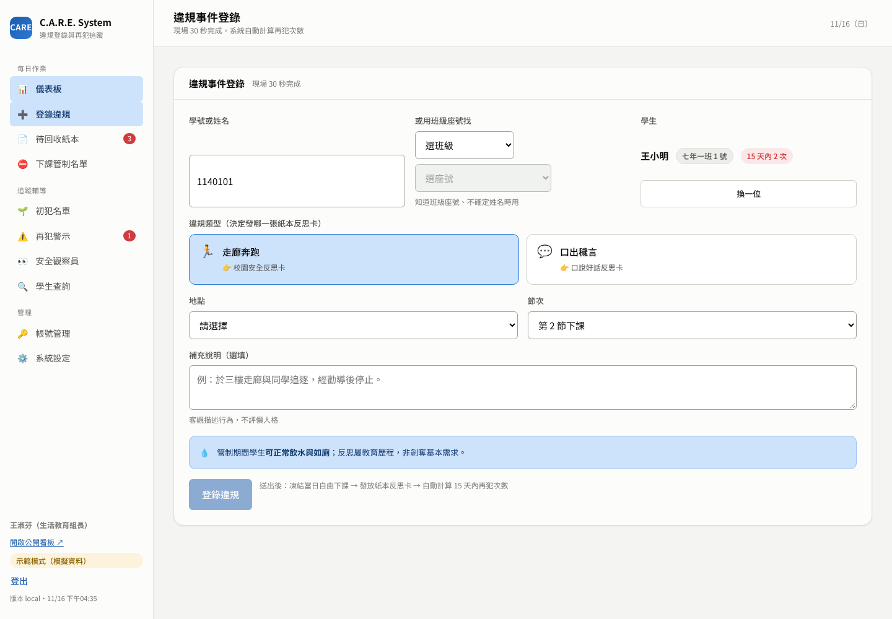
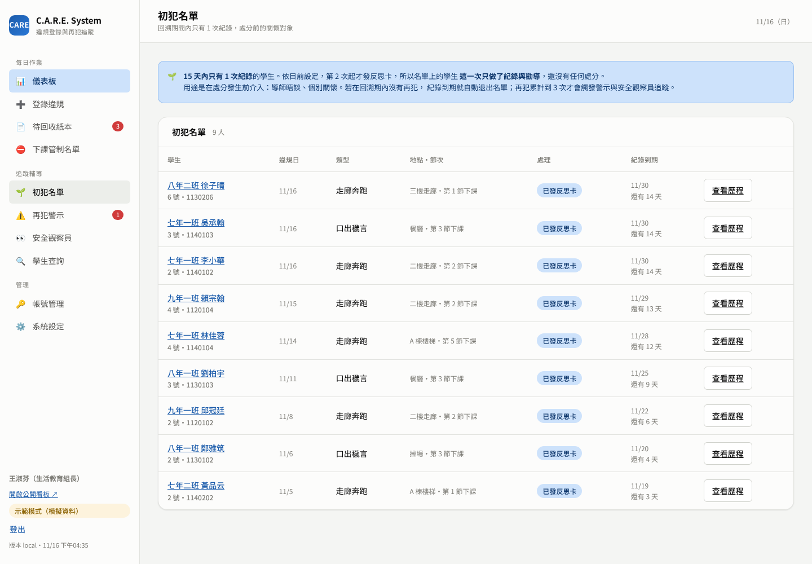
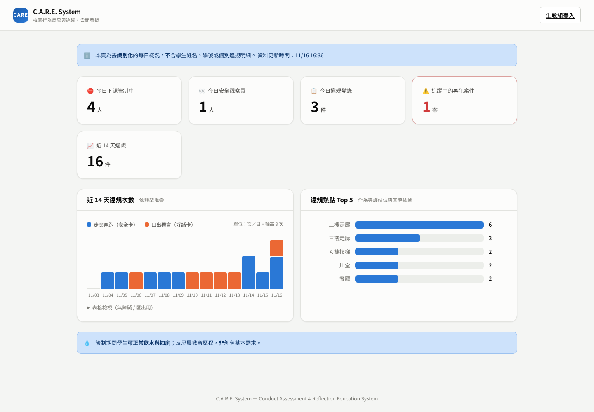
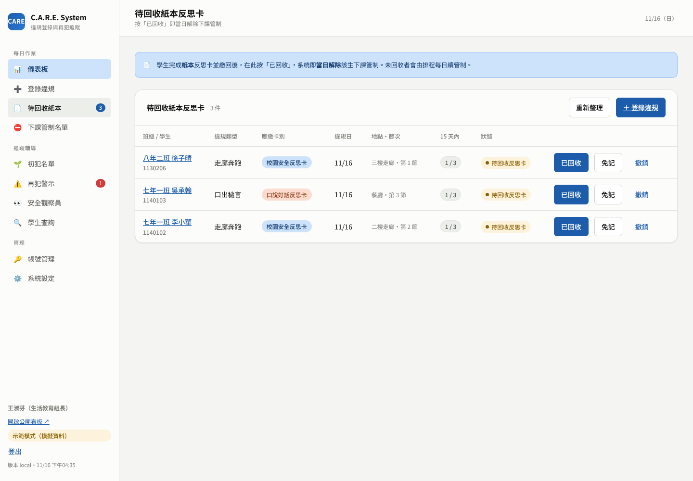
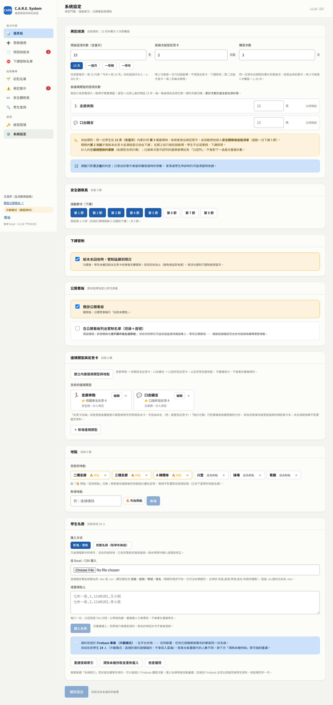

# C.A.R.E. System

**Conduct Assessment & Reflection Education System**
校園生活管教 — 違規登錄與再犯追蹤系統

紙本反思卡照舊，系統負責最難用手算的部分：**自動追蹤每位學生回溯期間內的再犯次數**，
達門檻立即警示並排入安全觀察員追蹤，同時管理每日下課管制名單。

```
使用者：生活教育組長一人操作（其他老師看公開唯讀看板）
登入：Google 帳號（管理者於畫面上授權，被授權者不需事先註冊）
前端：GitHub Pages（React + Vite + TypeScript）
資料：Firebase Firestore + Auth —— 完全在免費方案（Spark）內，不需信用卡
```

> 不使用 Cloud Functions（那需要付費方案）：業務邏輯在前端以 Firestore
> **交易**執行，權限與資料形狀由**安全規則**把關（31 項自動化測試）。

## 功能介紹影片

3 分 24 秒，全程是**實際操作畫面**（示範模式的模擬資料），含繁體中文字幕與配樂。
從登入、登錄違規、發卡與回收，一路走到追蹤輔導、後台設定與公開看板。

### ▶ [點這裡線上觀看（附章節，免下載）](https://znxuyz.github.io/C.A.R.E.-System/watch.html)

[](https://znxuyz.github.io/C.A.R.E.-System/watch.html)

↑ 點圖即可播放。上面這段動圖是其中 20 秒（同一位學生期間內第二次 → 發卡並凍結當日自由下課）。

> 影片檔隨前端一起部署於 GitHub Pages，因此可以直接在瀏覽器播放。
> 原始檔也在版控內（[`web/public/media/care-system-intro.mp4`](web/public/media/care-system-intro.mp4)，22 MB）；
> GitHub 的檔案頁不會播放版控中的影片，只提供 Download raw file。

| 段落 | 內容 |
|---|---|
| 片頭 | 「他這是第幾次了？」—— 紙本照舊，難的是計次 |
| 每日作業 | 登入 → 儀表板 → 登錄（兩種找人方式）→ 第一次只記錄勸導 → 第二次發卡凍結 → 回收解除 → 管制名單 |
| 追蹤輔導 | 初犯名單 → 再犯警示與認列依據 → 安全觀察員值勤 → 學生歷程 |
| 設定與權限 | 參數可調、違規類型與反思卡自訂、Excel 名冊匯入、帳號授權、公開看板 |
| 收尾 | 架構與成本、正向管教的提醒 |

影片本身也是可重跑的程式：錄影腳本、標題卡、配樂合成與字幕時間軸都在
[`video/`](video/README.md)，改了介面重跑一次即可更新。



## 核心功能

| 模組 | 說明 |
|---|---|
| **違規登錄** | 用**學號、姓名或班級**都能找人（子字串比對，打「小明」就找得到），也可直接選**班級＋座號**；選好的學生會帶出「回溯期間內已幾次」。選類型、地點、節次即完成 |
| **分級處理** | 期間內**第一次只做記錄與勸導** —— 不發反思卡、下課照常；**第二次起**才發卡並凍結當日自由下課。起算次數可調，設 1 則每次都發 |
| **自動再犯偵測** | 每筆登錄自動回溯**預設 15 天（含當天）**；累計達**預設 3 次**即發出警示，並自動排入安全觀察員追蹤清單。天數與次數都可在後台調整 |
| **分項回溯天數** | 回溯天數可**依違規類型分別設定**（例如走廊奔跑看 15 天、口出穢言看 30 天）。每一筆違規各自用它那一類的天數回推，**累計次數仍是全部合併計算** |
| **初犯名單** | 期間內只有 1 次紀錄、還沒有任何處分的學生，並標示紀錄何時到期。用途是在處分發生前介入：導師晤談、個別關懷 |
| **紙本回收追蹤** | 學生繳回紙本反思卡後按「已回收」→ **當日**解除下課管制；未回收者於**當天第一次開啟系統時**自動續帳管制 |
| **安全觀察員** | 一日下課 5 節（扣除打掃與 5 分鐘短下課）至學務處值勤，逐節打卡並記錄勸導人數；繳回紙本行為檢討書後 **隔日（下一個上課日）** 解鎖 |
| **學生名冊** | 直接上傳 **Excel／CSV**（Big5 亦可）。分「新增／更新」與「完整名冊（新學年換屆）」兩種模式；換屆時以學號為準，檔案中沒有的學生**停用而非刪除**，違規歷程全部保留 |
| **公開唯讀看板** | 其他老師不需帳號即可查看每日概況；**預設只顯示統計數字**，不含姓名、學號與個別明細 |
| **正向管教保障** | 管制期間**可正常飲水與如廁**（介面常駐提示，安全規則層級強制）；免記／撤銷須填事由；所有動作寫入稽核軌跡 |
| **後台設定** | 回溯天數、觸發次數、發卡起算次數、值勤節次、管制續行、公開看板、違規類型與反思卡名稱、地點與熱點，皆由管理者在「系統設定」頁調整，不需改程式 |
| **帳號管理** | 管理者以 Google 信箱授權生教組同仁；可隨時取消（下一次請求即失效） |

## 畫面

| 違規登錄 | 初犯名單 |
|---|---|
|  |  |

| 公開唯讀看板（免登入） | 待回收紙本 |
|---|---|
|  |  |

| 系統設定（校規參數不必改程式） |
|---|
|  |

## 文件

| 文件 | 內容 |
|---|---|
| [技術架構](docs/architecture.md) | 系統組成、技術選型、分層原則、權限與隱私模型、成本概估 |
| [資料庫綱要](docs/database-schema.md) | Firestore 集合與文件結構、ER 圖、複合索引、安全規則要點 |
| [再犯偵測演算法](docs/recidivism-algorithm.md) | 回溯視窗與門檻的語意界定、TypeScript 與 Firestore 交易實作、SQL 等價版、併發與幂等 |
| [生教組端 UI 規劃](docs/ui-spec-discipline.md) | 使用情境、資訊架構、逐頁版面與設計決定、狀態色彩、無障礙規範 |
| [作業流程](docs/workflow.md) | 每日流程時序圖、案件狀態、下課管制生命週期、續帳作業 |
| [**Firebase 設定手冊**](docs/firebase-setup.md) | **第一次導入照著點即可**：建專案、開 Google 登入、部署、授權、驗收、費用與疑難排解 |
| [部署指南](docs/deployment.md) | 本機開發、部署指令與維運（設定細節見上方手冊） |
| [介紹影片製作流程](video/README.md) | 錄影腳本、標題卡、配樂合成、字幕時間軸，可完整重跑 |
| [SQL 參考實作](docs/sql/recidivism.sql) | 關聯式等價版本 + [10 項自我驗證斷言](docs/sql/recidivism_test.sql)（PostgreSQL 16 驗證通過） |

## 快速開始

```bash
npm ci

# 免 Firebase 直接預覽（示範模式：模擬資料，可完整走完流程）
npm run dev:web        # http://localhost:5173

npm test               # 64 項單元測試（再犯演算法、日期視窗、案件規則、名冊、搜尋）
npm run test:rules     # 31 項 Firestore 安全規則測試（自動啟動模擬器，需 JDK 21）
npm run typecheck
npm run build
```

部署步驟見 [部署指南](docs/deployment.md)。未設定 Firebase 金鑰時，
前端會自動以**示範模式**運作，適合先向學務處演示操作動線。

推上 `main` 後由 GitHub Actions 自動部署：`deploy-pages.yml` 發布前端、
`deploy-rules.yml` 發布安全規則與索引（需 repo secret `FIREBASE_SERVICE_ACCOUNT`）。

## 專案結構

```
web/src/core/domain/      ★ 純領域層：再犯演算法、日期視窗、案件規則、學生搜尋（可單元測試）
web/src/core/services/      以 Firestore 交易實作：違規登錄、觀察員、管制帳、名冊與索引、
                            帳號授權、每日續帳、公開看板
web/src/pages/              公開看板 + 生教組 10 頁
web/test/                   單元測試 64 項 + 模擬器安全規則測試 31 項
firestore.rules             唯一防線：權限判定 + 每筆寫入的形狀與時間戳驗證
firestore.indexes.json      6 筆複合索引（也可在 Console 手動建立）
scripts/deploy-firestore.mjs  以 REST API 發布規則與索引（CI 用，不依賴 firebase-tools）
seed/                       管理者授權、系統參數、違規類型、地點、示範資料
web/public/watch.html       介紹影片的播放頁（隨前端部署，故可線上播放）
web/public/media/           介紹影片本體
video/                      介紹影片的錄影腳本、標題卡、配樂與合成流程
docs/                       架構、綱要、演算法、UI 規劃、設定手冊、介紹影片
```

## 關鍵設計決定

1. **再犯以「違規紀錄」計次，不以紙本回收計次** — 紙本晚繳不影響次數，避免拖延即免責。
2. **基準日用違規發生日而非登錄日** — 事後補登錄不會讓回溯視窗漂移。
3. **認列機制（`consumedByAlertId`）** — 觸發警示時把計入的違規標記給該次警示，
   第 4、5 次不會對同一波違規重複處分；演算法因此具幂等性，誤判撤銷時也會釋回額度。
4. **再犯偵測在 Firestore 交易內執行** — 同一節下課連續登錄兩筆時不會產生兩張警示。
   由於用戶端 SDK 的交易不能下查詢，計數改讀 `students/{id}.recidivismWindow` 快取；
   快取每筆都帶著類型代碼，分項天數才不會把長天數類型的紀錄提早刪掉。
5. **公開看板只讀一份去識別化摘要** — 公開頁不接觸任何業務集合；預設只有統計數字，
   即使開啟名單也只有班級＋座號，永不顯示姓名或學號。
6. **角色存於 Firestore 而非 token** — 取消授權下一次請求即生效，不必等 token 過期。
7. **下課管制採「每日一筆」帳** — 對應紙本每日重開一頁；同日多重來源須全部解除才解鎖。
8. **參數外置於 `settings/system`** — 天數／次數／節次可調，且每張警示留存當時參數快照，
   家長或學生申訴時仍可追溯當時依據。
9. **名冊壓成聚合索引（`rosterIndex`，每份 500 人）** — 搜尋若逐份讀 `students`，
   1000 人的學校每次載入就是 1000 次讀取；壓成分片後降為 2 次，另以版本文件讓各裝置
   判斷本機快取是否過期（換裝置或換帳號都看得到同一份名冊）。
10. **沒有排程器** — 免費方案不含 Cloud Functions，續帳改在「當天第一次開啟系統時」執行。

## 授權

MIT
